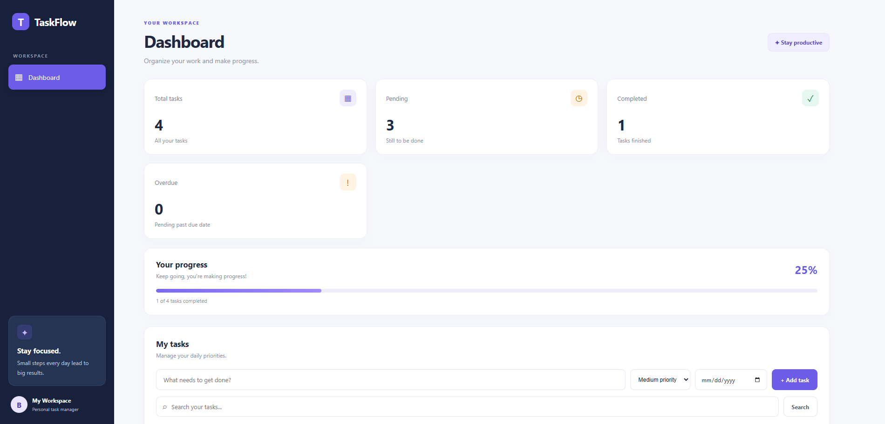
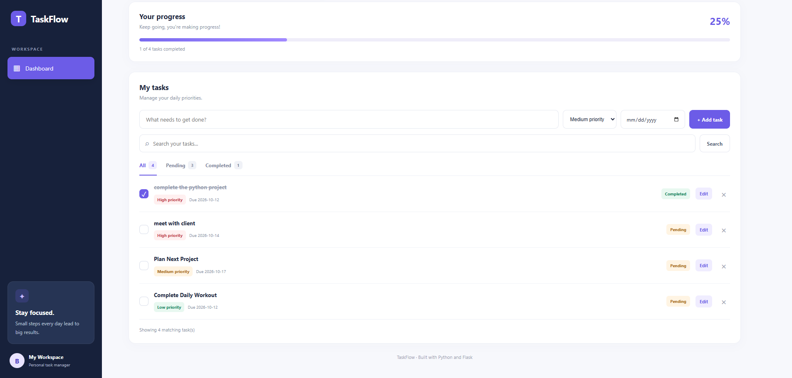
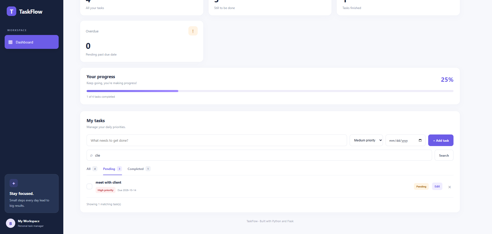

# Python To-Do Dashboard

A modern, web-based To-Do List application built with Python and Flask to help users organize, manage, and track their daily tasks.

## Features

- **Add Tasks:** Create tasks with a title, priority, and due date.
- **Edit Tasks:** Update task details whenever needed.
- **Complete Tasks:** Mark tasks as completed or pending.
- **Delete Tasks:** Remove tasks you no longer need.
- **Search Tasks:** Find tasks using keywords.
- **Filter Tasks:** View all, pending, or completed tasks.
- **Priority Management:** Organize tasks by Low, Medium, and High priority.
- **Due Dates:** Set deadlines and identify overdue tasks.
- **Dashboard Statistics:** View total, pending, completed, and overdue tasks.
- **Progress Tracking:** Monitor task completion progress.
- **Data Persistence:** Save tasks in a JSON file so they remain available after restarting the application.
- **Responsive UI:** A clean dashboard design with a white background, navy sidebar, and purple accents.

## Technologies Used

- Python
- Flask
- HTML5
- CSS3
- JavaScript
- JSON

## Project Structure

```text
Python_Todo_project/
├── app.py
├── tasks.json
├── templates/
│   ├── index.html
│   └── edit.html
└── static/
    ├── style.css
    └── script.js
```

## Installation and Setup

### 1. Clone the repository

```bash
git clone YOUR_GITHUB_REPOSITORY_URL
```

### 2. Open the project folder

```bash
cd Python_Todo_project
```

### 3. Install Flask

```bash
python -m pip install flask
```

### 4. Run the application

```bash
python app.py
```

### 5. Open the dashboard

Visit the following address in your browser:

```text
http://127.0.0.1:5000
```

## Learning Outcomes

Through this project, I practised:

- Python functions and conditional statements
- Lists and dictionaries
- File handling and JSON data storage
- Flask routes and web application development
- HTML forms and templates
- CSS styling and dashboard layout
- CRUD operations (Create, Read, Update, Delete)
- Basic input validation

## Project Purpose

This project was developed as a Python internship project to practise Python programming fundamentals and apply them in a practical web application.

## Future Improvements

- User authentication
- Task categories
- Notifications and reminders
- Database integration
- Deployment to a public hosting platform

---

**Project:** Python To-Do Dashboard  
**Status:** Completed  
**Built with:** Python and Flask
## Screenshots

### Main Dashboard


### Task Management


### Search and Filters


## Live Demo
https://python-todo-dashboard.onrender.com/